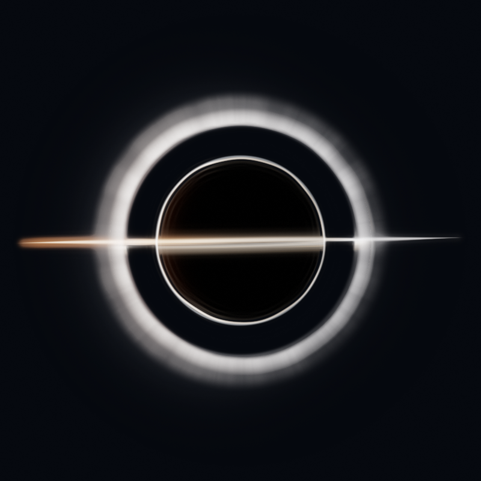

# 奇点 / Singularity

**一只运行在 Windows 桌面上的黑洞桌宠：实时引力透镜、紧凑设置面板、悬停系统状态与本地提醒工具。**

Rust + wgpu + WGSL 实时渲染，透明无边框窗口。单击核心会从黑洞中“吐出”设置面板；鼠标悬停核心会缓慢展开系统状态 HUD。



> 实际运行时窗口是透明叠层，黑洞会实时扭曲身后的桌面。

当前版本：**1.5.0**。技术架构与模块说明见 [`docs/code_specification.md`](docs/code_specification.md)。

---

### 从源码构建

环境：Windows 10 2004+ / Windows 11 x64，Rust stable + MSVC 工具链，支持 DX12 / Vulkan / OpenGL 的 GPU。

```powershell
cargo build --release
.\target\release\singularity.exe
```

测试与静态检查：

```powershell
cargo test
cargo clippy --all-targets
```

便携包：

```powershell
powershell -ExecutionPolicy Bypass -File .\package.ps1
# 输出 release\v1.5.0\Singularity.exe 与 Singularity-win64.zip（zip 内含 README、docs 与预览图）
```

首次构建需要联网拉取 crates；`.cargo/config.toml` 默认使用 `rsproxy.cn` 镜像。

---

## 交互

| 操作 | 行为 |
| --- | --- |
| 左键拖动黑色核心 | 移动黑洞，位置重启后保留 |
| 单击核心 | 从黑洞吐出 / 收回设置面板 |
| 双击核心 | 切换自由漫游 / 静止 |
| 悬停核心 | 系统状态 HUD 缓慢出现；移开后保留约 1.3 秒 |
| HUD 右上角 × | 立即关闭 HUD |
| HUD 待办圆圈 | 点击完成一条待办并立即保存 |
| HUD 底部按钮 | 上一首 / 播放暂停 / 下一首 / 静音 |
| 右键核心 / 托盘图标 | 打开 / 收起设置面板 |
| `Ctrl + Alt + B` | 全局显示 / 隐藏 |
| `Esc` / 点击面板外部 / × | 收起面板 |

设置面板页脚提供“重置位置”“隐藏”“退出”和“恢复默认”。恢复默认保留提醒、闹钟、待办、便签与专注状态。

---

## 特性

### 黑洞与桌面

- 纯黑事件视界、光子环、宽而柔和的透镜光环、近侧薄吸积带与远侧抬升光环。
- 实时捕获窗口背后的桌面并做屏幕空间引力透镜采样与轻微色散；窗口边缘前平滑归零，无方形接缝。
- 动态点击穿透：只有核心附近接收鼠标，其余区域交还桌面。
- 拖动、悬停视差、点击脉冲、双击漫游；面板/HUD 打开期间暂停漫游。
- 全屏应用自动隐藏；`Ctrl+Alt+B` 全局显隐；托盘、单实例、DPI 感知、设置持久化。
- 球体与外侧光环之间保留约 `0.42R` 透明环带，桌面透镜从缝隙中透出。

### 趣味互动（设置 → 行为 → 桌面互动）

- 桌面互动只有一个主开关“自动吸收桌面图标”，默认关闭；开启后按设定间隔自动吸收，演示按钮始终可用。
- 吸收间隔可在 30–300 秒之间调节：30 秒为高频，300 秒为低频，实际间隔有 ±18% 抖动；修改后立即重新计时。
- 只有开启主开关后才会自然触发；如果一直没看到，先确认开关已开、间隔不是 5 分钟，并且桌面图标未被窗口遮挡。
- 点击“演示吸收”才会立即演示：寻找当前可见的桌面快捷方式，用引力透镜吸入图标精灵，沿曲线移动到随机位置，白洞闪光后吐出。
- 吐出时图标会飞出黑洞窗口覆盖区，落在桌面可见位置，并有 0.72 秒的放大飞行，不需要拖动黑洞才能看到。
- 原图标区域由补丁遮住，精灵缩小飞入、放大吐出，再与真实图标无缝交接。
- 只通过桌面 ListView 移动快捷方式位置；不修改、删除或重命名任何文件。
- 面板打开、全屏、暂停、拖拽时不会触发吸收；失败通过托盘气泡提示。
- **引力波圆环**为默认效果：约 10–24 秒一次，向外扩散并扭曲背景。

### 设置面板（360 × 500 DIP）

- 左键单击核心，面板从黑洞中心缩放、位移、淡入并“吐出”；再次点击核心收起。
- 打开约 0.52 秒、收起约 0.26 秒；出现阶段靠近黑洞的部分会做 CPU 透镜弯折。
- 启动时预渲染完整面板与 HUD，首次打开/首次悬停不再因字体/GPU 管线初始化而卡顿。
- 紧凑玻璃卡片视觉：圆角卡片、分段页签、拨动开关、细滑杆、悬停高亮、细滚动条。
- 页签与功能：
  - **外观**：黑洞半径、桌面透镜强度、8 色吸积光预设、自定义 `#RRGGBB`。
  - **行为**：自由漫游/速度、整个工作区/框选范围、暂停动画、全屏隐藏、桌面互动与演示吸收。
  - **提醒**：专注计时、5/15/30/60 分钟快捷提醒、1–180 分钟自定义提醒、`HH:mm` 每日闹钟、待触发列表。
  - **待办**：多行便签与待办列表，支持添加、勾选完成、删除、本地持久化。

### 系统状态 HUD（悬停）

- 鼠标进入核心附近后，HUD 从黑洞中心缓慢吐出，停在黑洞窗口外侧，不与本体/辉光重叠。
- 304 × 364 DIP 的紧凑卡片：状态脉冲点、CPU/GPU/内存/电池四条细状态条（各自配色，电池低电量变红）、待办摘要、媒体图标按钮。
- 待办：最多显示 3 条未完成项与未完成总数；点击左侧圆圈即完成并持久化；无待办时显示“暂无待办”，全部完成时显示“全部完成”。
- CPU `GetSystemTimes`；内存 `GlobalMemoryStatusEx`；电池 `GetSystemPowerStatus`；GPU 使用 PDH 英文计数器 `\GPU Engine(*)\Utilization Percentage`（取最大引擎值），不可用时显示 `—`。
- 1 秒采样；HUD 靠近黑洞的一侧仍做 CPU 径向/旋涡弯折，完全移出后恢复清晰。
- **媒体控制**：卡片底部图标按钮，发送 Windows 系统媒体键，控制当前播放器，不读取曲目元数据。
- 鼠标离开黑洞或 HUD 后保留约 1.3 秒再收回；卡片右上角 × 可立即关闭；移到卡片上会一直保持。

### 专注、提醒与待办

- 专注：25/45/60 分钟快捷开始（默认 25 分钟）；专注期间黑洞缓慢呼吸；可随时结束；结束时托盘气泡提醒。
- 提醒：快捷生成 5/15/30/60 分钟提醒；自定义 1–180 分钟；逐项启用/禁用、删除、提示音开关。
- 闹钟：`HH:mm` 时钟闹钟与每日重复，到点托盘气泡 + 黑洞脉冲。
- 便签：多行输入，`Ctrl+Enter` 或“记下”添加；逐条删除；最多 100 条。
- 待办：输入回车或点击“添加”；完成项保留，可手动删除。
- 全部数据本地持久化，应用默认完全离线。

---

## 数据与调试

| 内容 | 路径 |
| --- | --- |
| 设置 | `%APPDATA%\Singularity\settings.json` |
| 日志 | `%APPDATA%\Singularity\singularity.log` |
| 发布可执行文件 | `target\release\singularity.exe` |
| 便携发行包 | `release\v1.5.0\Singularity.exe`、`release\v1.5.0\Singularity-win64.zip` |

- 设置采用临时文件 + 重命名原子写入；解析失败时保留 `.bad` 备份并回退默认值。
- Debug 构建会在终端输出日志。
- `--snapshot` 离屏渲染 shader 快照，不创建桌面窗口。
- `--icons` 打印桌面 ListView 中的可见图标，用于调试趣味互动。
- `SINGULARITY_ICON_DEBUG=1` 配合 `--icons` 输出每个 item 的矩形/可见性详情。
- `SINGULARITY_PANEL_PERF=1` 输出面板每帧耗时。

### 截图与引力透镜

默认启用 `WDA_EXCLUDEFROMCAPTURE`，黑洞不会出现在系统截图、录屏或会议共享中。开发时如需截图：

```powershell
$env:SINGULARITY_ALLOW_CAPTURE = "1"
.\target\debug\singularity.exe
```

该开关会同时关闭桌面透镜，避免程序把自己的画面再次捕获进透镜形成递归画中画。看到透镜消失时，先检查：

1. 是否设置了 `SINGULARITY_ALLOW_CAPTURE=1`；
2. 设置 → 外观 → 桌面透镜是否为 `0`；
3. 是否在远程桌面/无 GPU 捕获环境。

趣味互动使用的补丁/图标精灵窗口不设 WDA，可能出现在截图/录屏中，这是预期。

---

## 项目结构

```text
Singularity/
├─ src/
│  ├─ main.rs             入口、模块声明、--snapshot / --icons
│  ├─ app.rs              窗口消息、帧循环、漫游、面板/趣味/HUD/媒体集成、托盘
│  ├─ panel.rs            360×500 egui 设置面板、预渲染、动画缓存、CPU 透镜
│  ├─ stats.rs            304×364 悬停系统状态 HUD、待办、媒体按钮、CPU 透镜
│  ├─ ui.rs               共享 egui 画布、主题、颜色、组件与动画辅助
│  ├─ sysmon.rs           CPU/GPU/内存/电池 1s 采样线程（PDH/GetSystemTimes）
│  ├─ fun.rs              趣味状态机、补丁窗口、图标精灵、涟漪/白洞
│  ├─ desktop_icons.rs    桌面 ListView 图标枚举、可见性、移动、inpaint、精灵裁切
│  ├─ capture.rs          GDI BitBlt 桌面捕获
│  ├─ region.rs           全屏框选漫游区域
│  ├─ win.rs              分层窗口、点击穿透、WDA、DPI、单实例、托盘
│  ├─ render.rs           wgpu 设备/管线/HDR/合成/桌面纹理上传/回读
│  ├─ shader.wgsl         黑洞场景与自发光
│  ├─ composite.wgsl      桌面透镜、趣味吸入/涟漪/白洞、ACES、透明边缘
│  ├─ texture.rs          程序化吸积盘纹理
│  ├─ settings.rs         设置模型与原子持久化
│  ├─ log.rs              本地日志
│  └─ snapshot.rs         离屏渲染与 PNG 输出
├─ assets/
│  ├─ app.ico             应用/托盘图标
│  └─ preview.png         README 预览图
├─ docs/
│  └─ code_specification.md  完整代码说明书
├─ release/                  预编译产物（git 忽略，不过可以由 package.ps1 生成）
│  └─ v1.5.0/
│     ├─ Singularity.exe
│     └─ Singularity-win64.zip
├─ package.ps1            构建 + 生成 release\v<version> + zip
├─ build.rs               图标/版本资源
├─ Cargo.toml
├─ Cargo.lock
└─ README.md
```

渲染路径：WGSL 场景 → Rgba16Float HDR → 合成/泛光/ACES → BGRA 预乘 alpha → `UpdateLayeredWindow`。  
窗口边长约 `6.0 × 半径`；核心命中半径约 `1.3 × 半径`。

---

## 已知限制

- 趣味互动只移动桌面快捷方式的布局位置；Explorer 拒绝移动时会撤销补丁，原图标保持原位。
- 趣味目标必须是当前可见图标；桌面被窗口完全遮住时不会触发，会通过托盘提示。
- 图标精灵来自截屏裁剪，不同壁纸/图标背景下可能看到轻微矩形痕迹；白洞闪光会掩盖交接。
- 媒体控制只发送系统媒体键，不读取曲目/进度；不同播放器兼容性不同。
- GPU 状态依赖 PDH `GPU Engine` 英文计数器；部分系统/驱动可能不可用，此时显示 `—`。
- 没有 LLM / API / 聊天 / 文件读写 / 命令执行 / 网络请求。
- 没有安装器、代码签名、开机启动；发布为便携 exe/zip。
- WDA 默认排除截图；调试开关会同时关闭透镜。
- 未做 200% DPI / 4K / 低端 GPU 的系统性复测。
